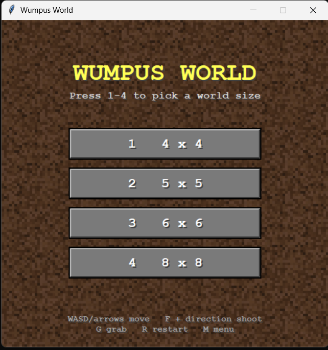
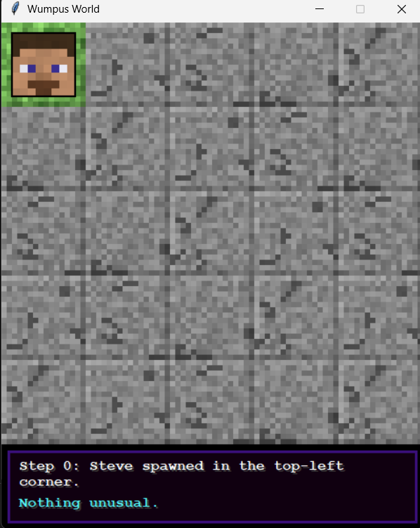
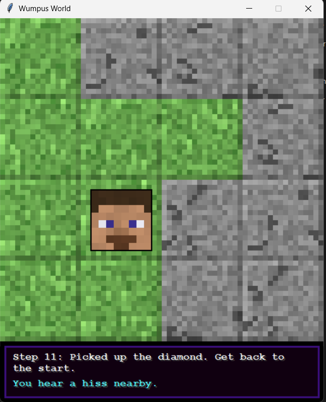
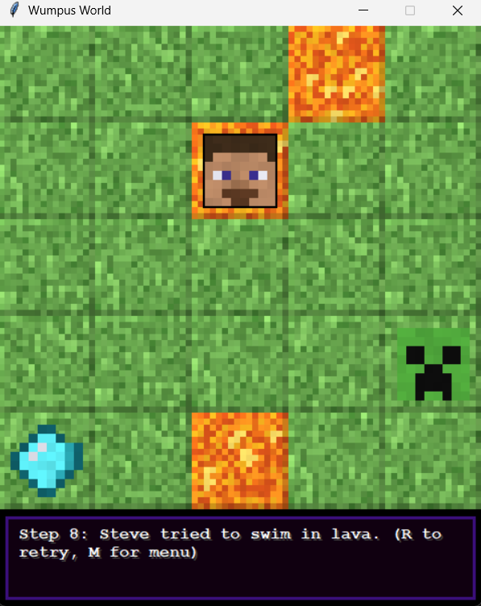
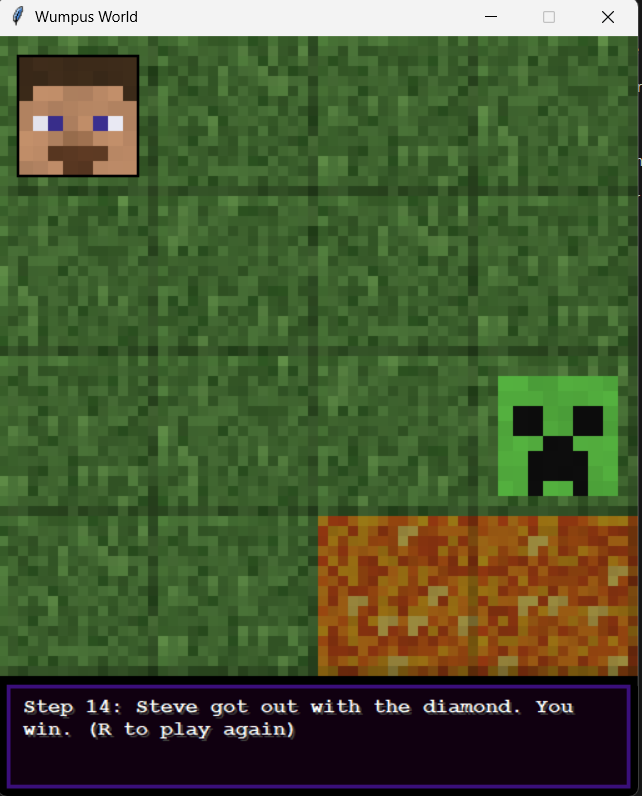

# Minecraft Wumpus World

A Python version of the classic Wumpus World puzzle with a Minecraft theme. You play as Steve, exploring a grid where you can't see what is ahead. Find the diamond, avoid the lava and the Creeper, and get back to the start.

Individual project for the course 21CSO352T Python Programming by **Mayank Umrey (RA2411005010070)** **SAMUEL LAWRENCE M (RA2411005010085)**.

Built with Python and tkinter. No images or extra libraries are needed, all the textures are drawn in code.

## Objectives

- Implement the Wumpus World rules: hidden hazards, hints about nearby danger, one arrow, and a goal of returning to the start with the treasure.
- Let the player choose the board size (4x4, 5x5, 6x6 or 8x8).
- Use a Minecraft theme (Steve, Creeper, lava, diamond).
- Add original features so it is more than the standard version.
- Make sure every generated world can be won.
- Keep the game rules separate from the graphics.

## Requirements

- Python 3.7 or newer
- tkinter (included with Python on Windows and macOS)

On some Linux systems tkinter is installed separately:

```
sudo apt install python3-tk
```

## Installation

The project is packaged with `pyproject.toml` and is installed with pip from the project folder:

```
pip install .
```

This installs the game and a `wumpus-world` command.

## How to run

After installation the game is started with:

```
wumpus-world
```

Without installing, the game runs directly from the project folder:

```
python main.py
```

The world size is chosen on the start screen with the number keys:

| Key | Size  |
|-----|-------|
| 1   | 4 x 4 |
| 2   | 5 x 5 |
| 3   | 6 x 6 |
| 4   | 8 x 8 |

## Controls

| Key                   | Action                      |
|-----------------------|-----------------------------|
| W A S D / arrow keys  | Move                        |
| F, then a direction   | Shoot the arrow             |
| G                     | Pick up the diamond         |
| R                     | Restart with the same size  |
| M                     | Back to the size menu       |

## How to play

You start in the top-left corner. Every block you haven't visited is hidden as grey stone, so you only learn about the world by walking around.

**Goal:** find the diamond, pick it up with G, then walk back to the top-left corner.

**Dangers:**

- Lava kills you if you step into it.
- The Creeper kills you if you and it end up on the same block.

The box at the bottom tells you what you sense. Only the four blocks touching you count (up, down, left, right), not diagonals.

| Message                              | Meaning                                |
|--------------------------------------|----------------------------------------|
| You hear a hiss nearby.              | The Creeper is on a block next to you. |
| It feels hot here.                   | Lava is on a block next to you.        |
| Something shiny is here. Press G.    | You are standing on the diamond.       |

You have one arrow. Press F and then a direction. The arrow flies in a straight line to the edge of the board, and kills the Creeper if it is anywhere on that line.

## Wumpus World vs. this version

| Classic Wumpus World | This game |
|----------------------|-----------|
| Agent                | Steve     |
| Wumpus               | Creeper   |
| Pits                 | Lava      |
| Gold                 | Diamond   |
| Breeze               | "It feels hot here." |
| Stench               | "You hear a hiss nearby." |
| Glitter              | "Something shiny is here." |

## What is different from the normal game

- **The Creeper wanders.** Every few steps it moves to a nearby block that is not lava, so an old hint may no longer be true.
- **Day and night.** The game switches every 12 steps. At night the board is darker and the Creeper moves every 3 steps instead of every 6.
- **Only winnable worlds.** The generator checks that the diamond can be reached from the start without crossing lava, and generates again if not.
- **Safe start.** The 2x2 area in the top-left corner never has lava, the Creeper or the diamond.

## Project structure

```
main.py               the complete game
pyproject.toml        packaging and the wumpus-world command
screenshots/          screenshots of the program running
README.md
```

`main.py` is divided into sections: constants, texture and sprite generation, the game rules (`World` class), and the window, menu and keyboard input (`App` class). The `World` class has no tkinter code in it, so the game rules are independent of the interface.

## Screenshots

**Start screen**



**New game on a 5 x 5 board**



**Exploring a 4 x 4 board**



**Game over by lava**



**Winning screen**



## References

- S. Russell and P. Norvig, *Artificial Intelligence: A Modern Approach*, 4th ed., Pearson, 2020 (Wumpus World environment).
- G. Yob, "Hunt the Wumpus", 1973.
- Python documentation: [tkinter](https://docs.python.org/3/library/tkinter.html) and [random](https://docs.python.org/3/library/random.html).
- Minecraft by Mojang Studios, used only as the theme. All characters and blocks are redrawn in code.
